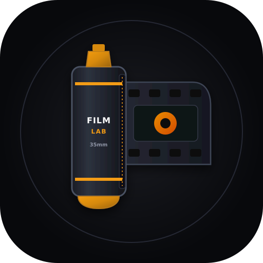
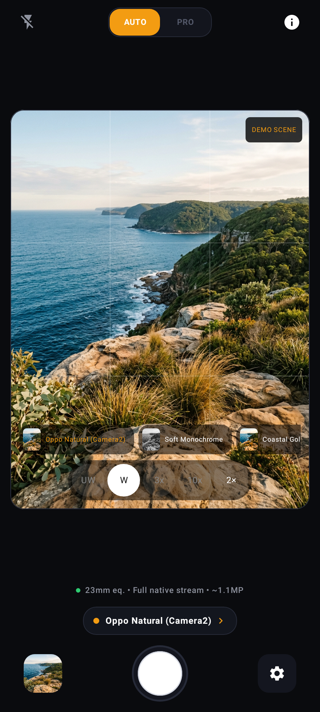
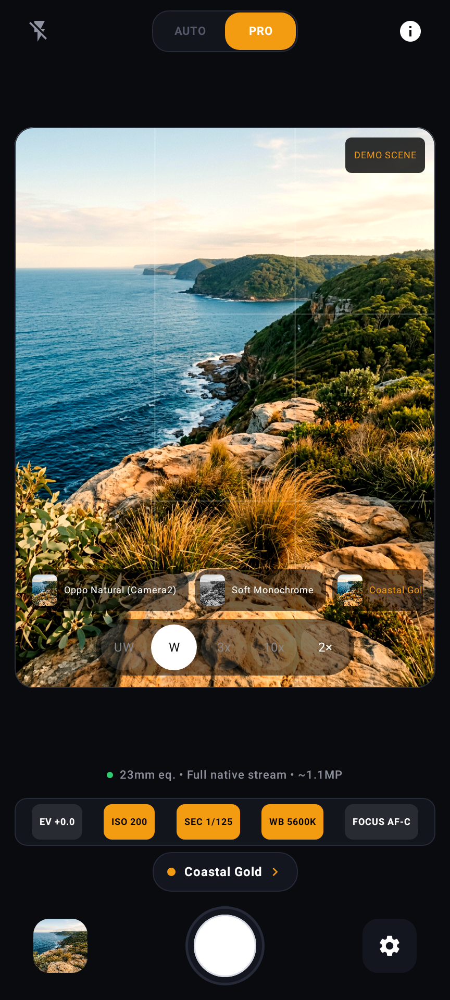
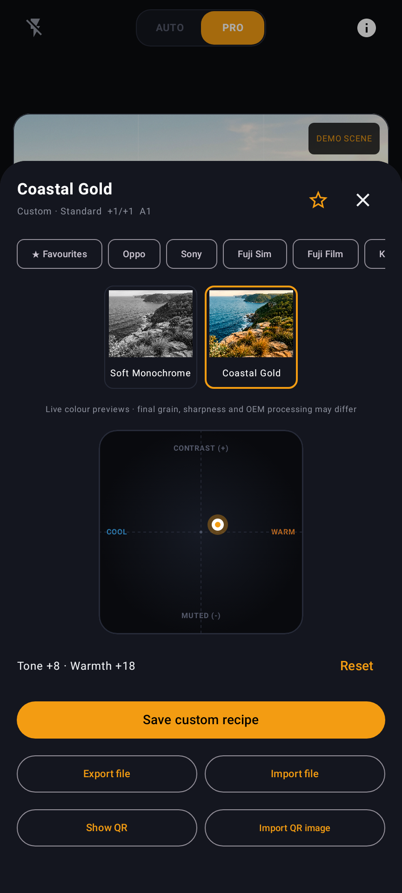

<p align="center">
  
</p>

# MobileFilmLab

**A photos-only Android camera with film-inspired looks and a spacious AUTO / PRO workflow.** Open source · GPL-3.0-or-later · Android 9+

[](https://github.com/TheSwagInDisguise/MobileFilmLab/actions/workflows/ci.yml)

## First public beta

**[Download v0.2.0-beta.1](https://github.com/TheSwagInDisguise/MobileFilmLab/releases/tag/v0.2.0-beta.1)** · [Testing guide](docs/TESTING.md) · [Report a bug](https://github.com/TheSwagInDisguise/MobileFilmLab/issues/new/choose)

### Built primarily for the Oppo Find X9 Ultra

The **Oppo Find X9 Ultra is the primary development and testing target**. We plan to expand compatibility to more devices with help from beta testers. Other phones may run the app, but camera access, lens availability and processing modes vary by device and firmware. Please share a [device compatibility report](https://github.com/TheSwagInDisguise/MobileFilmLab/issues/new?template=device_support.yml) to help improve support.

This beta builds on a successful initial handset test of alpha.9. It is **ready for public testing, not a stable or universally validated release**. Keep another camera available for important photos; see [known limitations](KNOWN_LIMITATIONS.md).

## Features

- **AUTO and PRO** — uncluttered photo capture, tap-to-focus/meter, flash controls and hardware-limited manual exposure, white balance and focus.
- **Lens and framing controls** — fixed `UW`, `W`, `3x`, `10x` lens slots where exposed; 1× / 1.5× / 2× / 3× digital crops with honest resolution information.
- **80 built-in looks** — the complete 77-recipe upstream catalogue plus three independent camera baselines. Live colour previews, favourites and custom presets.
- **Hands-on look editing** — a two-dimensional Tone / Warmth pad, live before/after comparison and optional film grain.
- **Native output by default** — no mandatory enlargement. Unedited, uncropped baseline captures preserve the exposed camera JPEG pixel data; optional enlarged exports are labelled interpolation.
- **Composition and capture tools** — grids, a sensor-driven level, hardware shutter keys and optional haptic feedback. Photos only; no video mode.
- **Local gallery and recipe sharing** — swipe, zoom, inspect metadata, share or delete saved photos; import/export recipe files and QR images.
- **Optional experimental processing** — advertised HDR/Night extensions, three-frame JPEG fusion and reprocessing ZSL where supported. These are not guaranteed stock-camera equivalents.

## Screenshots

**Real app UI rendered with Android/Compose, using an AI-generated demo scene and illustrative state.** These are not handset screenshots or photographs captured by the app. `DEMO SCENE` is visible in the viewfinder. [Provenance and reproduction](docs/SCREENSHOTS.md).

<table>
  <tr>
    <td align="center"><br><strong>AUTO</strong></td>
    <td align="center"><br><strong>PRO</strong></td>
    <td align="center"><br><strong>Recipe editing</strong></td>
  </tr>
</table>

## Install and test

Download the **signed APK** from the release above and allow installation from your browser/file manager when Android asks. The release includes SHA-256 checksums and a testing guide. It uses the same package and signing certificate as the alphas, with a higher version code; install over the existing release rather than uninstalling to preserve custom recipes and favourites. Debug builds are separate apps.

No analytics, advertising or photo uploads. Photos and recipe processing stay on-device; network access is used only when you explicitly check for releases. [Privacy](docs/PRIVACY.md) · [Signing and verification](docs/RELEASE_SIGNING.md)

## Build and contribute

Use **JDK 17**, Android SDK/build tools **34** and the included Gradle wrapper. Minimum Android 9 / API 28. Direct APK distribution; no app-store availability claim.

```sh
./gradlew testDebugUnitTest --no-daemon
./gradlew lintRelease --no-daemon
./gradlew assembleDebug --no-daemon
```

[Contributing](CONTRIBUTING.md) · [Architecture](ARCHITECTURE.md) · [Documentation](docs/README.md) · [Changelog](CHANGELOG.md)

## Thanks and attribution

- **[voxivoid](https://github.com/voxivoid)** — author of the [upstream recipe project](https://github.com/voxivoid/recipe-lab-sony-pmca), whose complete 77-recipe catalogue and related concepts underpin this port.
- **[RandoTeam](https://github.com/RandoTeam)** — maintainers of a [camera interoperability reference](https://github.com/RandoTeam/OpOpenCam-Camera) consulted during public camera-API research; cited as a reference, not a claim that its code is incorporated.
- The Android open-source community and the maintainers of the libraries listed in [third-party notices](THIRD_PARTY_NOTICES.md).
- Early testers helping improve capture reliability, report firmware limitations and extend device compatibility.

Full provenance, upstream names and licensing notices remain in [upstream attribution](UPSTREAM_ATTRIBUTION.md), [third-party notices](THIRD_PARTY_NOTICES.md) and [LICENSE](LICENSE). This is an independent, unaffiliated project; third-party recipe labels are descriptive, and looks are approximations rather than official simulations or endorsements. [Third-party name policy](docs/THIRD_PARTY_NAMES.md).

## AI-development disclosure

**MobileFilmLab was developed substantially with AI assistance**, including generated code, tests, documentation and presentation assets, under human direction and with handset feedback. That is not a substitute for independent code review, security auditing or hardware validation. Bugs and inaccurate assumptions may remain. The demo scene above is also AI-generated; the UI itself is rendered from the app's source. [Full disclosure](docs/AI_DISCLOSURE.md).
